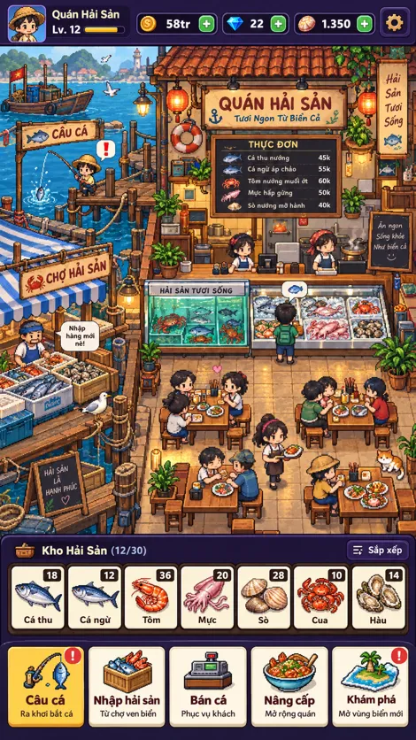

# 🐟 Quán Hải Sản – Câu Cá & Kinh Doanh

Pixel-art browser game PWA: cốt truyện **Chuyện Bến Nhỏ**, hướng dẫn đầu game, NPC khách hàng tự đi vào quán, câu cá, nhập hải sản, bán cá bằng **xu ảo**, nâng cấp quán, khám phá vùng biển và **ủng hộ tự nguyện qua ảnh QR ngân hàng của tác giả**. Không có giao dịch tiền thật trong game, không tích hợp VietQR hay cổng thanh toán.



## Công nghệ

- Next.js 16 (App Router), React 19, TypeScript, CSS responsive
- Phaser 3.90 cho bản đồ 2D và vùng tương tác
- Supabase Auth + PostgreSQL (tùy chọn, tạo project mới và dùng migration)
- PWA: manifest, icon 192/512, service worker cache tài nguyên

## Chạy ngay

Yêu cầu Node.js 20.9+ và npm (khuyến nghị Node 22).

```bash
npm install
cp .env.example .env.local
npm run dev
```

Mở <http://localhost:3000>. Khi chưa cấu hình Supabase, game chạy ở **demo mode** với dữ liệu lưu `localStorage`, chơi được ngay, gồm câu cá mini-game, nhập hàng, bán cá, nâng cấp và khám phá.

## Kết nối Supabase do bạn tạo

1. Vào <https://supabase.com/dashboard>, tạo project mới cho game. Không dùng một database có dữ liệu quan trọng khác.
2. Supabase Dashboard → **SQL Editor** → chạy toàn bộ file [`supabase/migrations/202611010001_initial_game.sql`](supabase/migrations/202611010001_initial_game.sql).
3. Trong Auth → Providers bật **Email**, cấu hình xác thực OTP/magic link; trong Auth → URL Configuration, thêm URL chạy thật và `http://localhost:3000` vào Redirect URLs.
4. Đặt **Project URL** và **publishable key** (không bao giờ dùng secret/service role trên client) vào `.env.local`:

```env
NEXT_PUBLIC_SUPABASE_URL=https://YOUR_PROJECT.supabase.co
NEXT_PUBLIC_SUPABASE_PUBLISHABLE_KEY=sb_publishable_YOUR_KEY
NEXT_PUBLIC_DONATE_NAME=Tên tác giả (không bắt buộc)
```

5. Khởi động lại `npm run dev`, mở **Tài khoản** trong game rồi đăng nhập bằng email. Tiền ảo, kho và upgrade sẽ lưu ở Supabase. Dữ liệu demo local không được import vào cloud.

**Bảo mật:** bảng bật RLS, client chỉ có quyền SELECT dữ liệu của chính mình. Mọi thay đổi xu và tồn kho phải qua PostgreSQL RPC `game_action()` kiểm tra chủ sở hữu, giá, số lượng và cooldown. Không bật chính sách UPDATE trực tiếp trên `game_saves`. RPC dùng SECURITY DEFINER có kiểm tra `auth.uid()`, thu hồi EXECUTE từ `PUBLIC/anon` và giới hạn cho `authenticated`.

## QR Donate riêng, không qua VietQR API

Dùng ảnh QR có sẵn của ngân hàng bạn; lưu đúng tên file `public/donate-qr.png`. Popup sẽ hiển thị ảnh khi có file. **Tuyệt đối không đưa số tài khoản/bí mật API vào source hoặc environment nếu không cần.** Không có tự động kiểm tra chuyển khoản, không đổi donate lấy xu hay vật phẩm.

## PWA

- Có manifest tại `/manifest.webmanifest`, icon 192/512 và service worker `/sw.js`.
- Cài đặt qua **Add to Home Screen / Thêm vào màn hình chính** trên trình duyệt. Trên điện thoại, trải nghiệm tốt nhất khi deploy HTTPS.
- Sau lần tải đầu, PWA có thể hiển thị shell/asset đã cache ở chế độ offline. Supabase cần internet; chế độ demo chơi offline và lưu ngay trên thiết bị.
- Service worker không cache request API hoặc Supabase để tránh hiển thị dữ liệu người dùng cũ.

## Kiểm thử & build

```bash
npm run test
npm run typecheck
npm run build
```

## Deploy

Push repo lên GitHub, import repo vào Vercel, cấu hình 2 biến `NEXT_PUBLIC_SUPABASE_*` trong **Environment Variables**. Truy cập HTTPS để cài PWA. Supabase Auth redirect URLs phải chứa domain chính xác. Nếu không cấu hình Supabase thì ứng dụng vẫn hoạt động ở demo mode.

## Story Mode + onboarding + khách hàng tự di chuyển

- **Hướng dẫn đầu game** gồm 4 thao tác: câu cá thành công, nhập một món, bán một món và mở nhật ký. Có thể bỏ qua, hoặc vào Cài đặt → **Xem lại hướng dẫn đầu game**. Bước hướng dẫn được ghi nhớ trong `localStorage` của thiết bị.
- **Chuyện Bến Nhỏ** có 5 chương với hội thoại và mục tiêu, mở chương tiếp theo tự động theo số cá đã câu, số cá đã bán, số lần nâng cấp và vùng biển đã mở. Thành tích đã có trong `game_saves`; không cần sửa migration.
- **Khách NPC Phaser** được vẽ bằng những sprite pixel riêng, sinh ngẫu nhiên theo thời gian, đi từ cổng đến bàn, chờ gọi món rồi ra khỏi quán. Nhấn khách để mở cửa sổ bán cá; sau khi bán thành công một khách đang đợi sẽ rời quán vui vẻ.
- Trạng thái chờ của NPC hiện là **mô phỏng trên client**, không phải hệ thống đơn hàng đã xác thực trên máy chủ. Tiền xu và kho vẫn do Supabase RPC xác thực nếu đăng nhập. Nâng cấp sang bản production có thể dùng hàng đợi khách và order ở backend.
- Cốt truyện và mục tiêu trong `src/lib/story.ts`; phần hiển thị ở `src/components/StoryPanel.tsx`; NPC ở `src/game/HarborStage.tsx`.

## Gói asset Pixel Art gốc (mới)

Trong `public/assets/pixel/` có **30 hình PNG** tạo riêng cho Quán Hải Sản: 7 icon hải sản; 6 sprite sheet nhân vật 4 hướng × 4 frame (mỗi cell 64 × 96 ở tỷ lệ xuất x2); 10 vật dụng tương tác; 5 tranh cốt truyện; 2 ảnh chân dung. Mỗi asset có nền trong suốt nếu phù hợp và có thể dùng độc lập trong game. File catalog là `public/assets/pixel/catalog.json`.

- NPC Phaser trong quán dùng sprite sheet và frame chuyển động thay cho nhân vật khối hoặc emoji.
- Kho, danh sách nhập/bán hải sản, mini-game câu cá và các chương truyện dùng asset PNG riêng.
- `public/assets/audio/` gồm 6 âm thanh WAV tự tổng hợp (click, coin, catch, splash, upgrade, chime). Âm thanh thao tác chỉ chạy sau hành động người chơi; có thể tắt bằng `localStorage.setItem('qhs-sound-off','1')`.
- Truy cập **`/preview/`** bằng server static hoặc `preview/index.html` để xem thư viện sprite; mã nguồn tạo asset ở `tools/generate_assets.py` và `tools/generate_audio.py`.
- Asset độc lập được sản xuất theo phong cách đã chọn, **không phải bản sao tài nguyên game Ốc Đêm**.

### Xem ngay mà không cần npm

```bash
python3 -m http.server 8080
# http://localhost:8080/demo/
# http://localhost:8080/preview/
```

Nếu chưa tạo Supabase, game Next.js chơi local với tiền ảo và tự lưu trên máy. `donate-qr.png` hiện chưa có vì cần ảnh QR ngân hàng của bạn; popup có placeholder rõ ràng, không có VietQR API hay thanh toán trong game.

## Phạm vi MVP

Đã có: giao diện theo concept, bản đồ tương tác Phaser và NPC di chuyển ngẫu nhiên, 5 chương truyện, hướng dẫn đầu game, mini-game câu cá canh lực, kho 7 loại hải sản, nhập hàng, bán bằng xu ảo, nâng cấp, mở vùng biển, demo autosave, Supabase Auth/RPC SQL, QR donate popup, PWA.

Chưa có: multiplayer, sprite-sheet chất lượng artist production, pathfinding tránh vật cản, cơ chế câu cá nâng cao, phần thưởng donate, thanh toán, tự động deploy công khai. Background là một ảnh concept art đã crop thành bản đồ; để đạt chất lượng production cần chia thành tile/sprite, bổ sung animation và âm thanh riêng.

## Giấy phép

MVP thử nghiệm. Tác phẩm đồ họa dùng concept được tạo riêng cho dự án; vui lòng thay thế/chỉnh sửa asset trước khi phát hành thương mại nếu cần.

## Xem playable preview không cần npm

Mở `demo/index.html` trong trình duyệt khi giải nén ZIP. Đây là bản preview HTML độc lập với các thao tác cơ bản, dùng cùng đồ họa và logic xu ảo để xem nhanh; PWA + Supabase nằm ở ứng dụng Next.js chính. Nếu trình duyệt chặn ảnh khi mở trực tiếp bằng `file://`, chạy `python3 -m http.server 8080` ở thư mục gốc và mở `http://localhost:8080/demo/`.

Hướng dẫn tạo repo GitHub khi connector thiếu quyền tạo: [`PUBLISH_GITHUB.md`](PUBLISH_GITHUB.md).


## Đưa lên GitHub

Công cụ GitHub trong phiên ChatGPT này **không có quyền tạo repository mới**, vì thế chưa có URL GitHub live. Xem `PUBLISH_GITHUB.md` để tạo một repo rỗng bằng giao diện GitHub rồi push toàn bộ source bằng lệnh terminal. Không gửi file HAR đã tải từ Ốc Đêm lên repository (có thể chứa token phiên).

## Bộ nhân vật đã chốt (01/11/2026)

Bản này có 7 nhân vật sprite 4 hướng, 4 bước/chu kỳ với cell 64×96 px (pixel logic 32×48): **Bạn, Chú Tám, Cô Sáu, Đầu bếp Lành, Phục vụ Mai, Khách nam, Khách nữ**. Ngoài sprite chơi được còn có 6 ảnh chân dung cắt từ bảng concept do dự án tự tạo và đã duyệt. Metadata ở `public/assets/pixel/character-manifest.json`.

Để sinh lại sprite từ code (không cần model tạo ảnh): `python3 tools/generate_character_set.py` (yêu cầu Pillow). Các chân dung WebP được giữ sẵn, không bị thay đổi khi sinh sprite. Bản vẽ concept và NPC sprites không hoàn toàn giống từng nét: portrait dùng trong giao diện truyện, còn sprite dùng để animate 4 hướng trên map.
